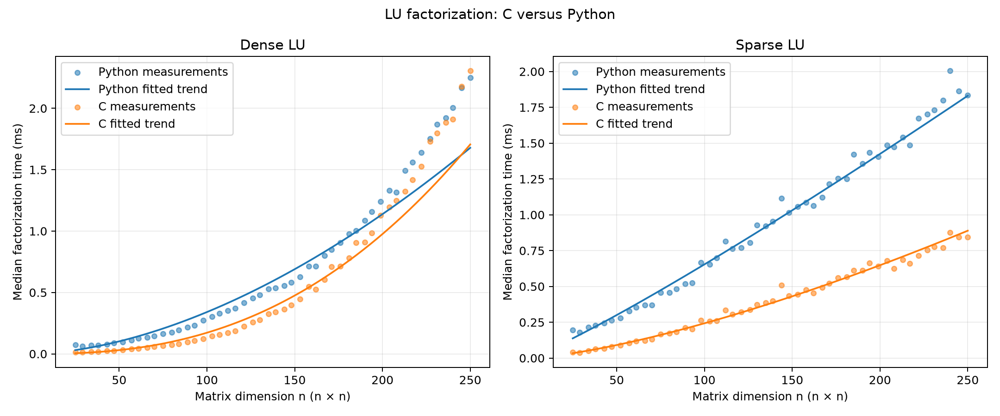

# Performance Benchmarking: C vs. Python

## Overview

This project investigates the performance of C and Python when performing dense and sparse LU factorization. The goal is to understand how programming language, libraries/implementation, and matrix structure affect  performance.

Established numerical libraries in both languages were used to make the comparison more representative of computing applications, rather than implementing factorizations from scratch. 

## Experimental Setup

I compared two methods of LU factorization:

- **Dense LU:** Uses standard dense matrix storage and factorization.
- **Sparse LU:** Exploits the fact that most matrix entries are zero.

The experiment uses square matrices with dimensions ranging from 25×25 to 250×250, with 50 different matrix sizes.

The matrix we use is symmetric with nonzero entries on the main diagonal and selected off-diagonals. The same matrix construction is used in C and Python.

### Libraries

| Operation | Python | C |
|---|---|---|
| Dense LU | SciPy `lu_factor` | LAPACKE `dgetrf` |
| Sparse LU | SciPy `splu` | SuperLU |
| Matrix storage | NumPy / SciPy | C arrays / SuperLU |

### Benchmarking Methodology

To improve reliability and comparability:

- Each matrix size is tested 1,000 times for each factorization method.
- The median runtime is reported to reduce sensitivity to outliers.
- Warm-up executions are performed before collecting measurements.
- Matrix sizes are interleaved to reduce the influence of system-load fluctuations.
- Dense matrix copying occurs outside the timed region.
- Numerical libraries are configured to use a single thread.

The benchmark results are saved as CSV files and visualized using Python.

## Results

The experiments investigate how factorization runtime changes with matrix dimension.

The primary findings concern:

1. The performance difference between dense and sparse factorization.
2. How C and Python compare when both use compiled numerical libraries.
3. The effect of benchmarking methodology and numerical-library configuration on measured performance.



The figure shows the measured median runtimes and fitted performance trends for both implementations.

## Running the Experiments

### Python

Install the required packages:

```bash
python -m pip install numpy scipy matplotlib
```

From the project directory, run:

```bash
python python/benchmark.py
```

### C

The C benchmark requires Clang or another compatible C compiler, LAPACKE, LAPACK, OpenBLAS, and SuperLU.

In an MSYS2 CLANGARM64 environment, compile using:

```bash
clang -O2 -std=c11 -I/clangarm64/include/superlu \
  c/benchmark.c -o /tmp/benchmark.exe \
  -lsuperlu -llapacke -llapack -lopenblas -lm
```

Run the benchmark with numerical libraries restricted to one thread:

```bash
OPENBLAS_NUM_THREADS=1 OMP_NUM_THREADS=1 MKL_NUM_THREADS=1 /tmp/benchmark.exe
```

For a controlled Python run, set the corresponding environment variables before starting Python.

### Generating the Graphs

After both benchmarks finish:

```bash
python python/plot_comparisons.py
```

The outputs are saved in the `results/` directory.

## Presentation

The presentation slides are available in the [`slides/`](slides/) directory.

## References

- [NumPy Documentation](https://numpy.org/doc/stable/)
- [SciPy Linear Algebra Documentation](https://docs.scipy.org/doc/scipy/reference/linalg.html)
- [SciPy Sparse Linear Algebra Documentation](https://docs.scipy.org/doc/scipy/reference/sparse.linalg.html)
- [LAPACK Documentation](https://www.netlib.org/lapack/)
- [SuperLU](https://portal.nersc.gov/project/sparse/superlu/)